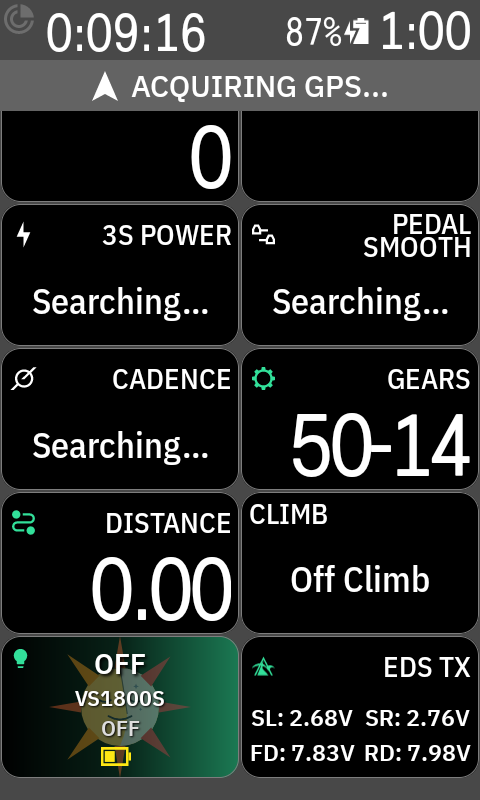

# KMagicWheeltopBlip 🚴‍♂️⚡🐵🚀

A Hammerhead Karoo extension for **Wheeltop EDS (TX, OX, GX, GeX)** electronic shifting systems and **Magicshine M0-C0 MJ_6558** wireless handlebar blip remotes.

This project is a new, native Android/Karoo (partial) re-implementation based on [drJeckyll's EDS-OX project](https://git.jeckyll.net/published/personal/eds-ox), specifically designed as a native Hammerhead Karoo extension to bring Wheeltop electronic derailleur telemetry and wireless gear shifting via the Magicshine BLE remote control directly to your (TT-)handlebar.

### 📊 Standalone Karoo Data Field (No Remote Required!)
Even if you do **not** use a wireless Blip remote, this extension provides a native, live **Karoo Data Field** that dynamically synchronizes its title and layout to your specific bound Wheeltop groupset model (e.g. `EDS TX`, `EDS OX`, `EDS GX`, `EDS GeX`). It displays real-time battery voltages for all active components (Left Shifter `SL`, Right Shifter `SR`, Front Derailleur `FD`, Rear Derailleur `RD`, or Remote `RM`). It automatically updates during rides, making it an indispensable telemetry companion for any Wheeltop EDS groupset rider on Hammerhead Karoo!

<p align="center">
  
</p>

---

> [!CAUTION]
> **⚠️ DISCLAIMER & WARNING**
>
> - **NO WARRANTY:** This software is provided "as is", without warranty of any kind, express or implied. Use entirely at your own risk.
> - **EXCLUSION OF LIABILITY:** The author(s) accept **NO RESPONSIBILITY OR LIABILITY** for any damage to your hardware (e.g., Wheeltop derailleurs, Karoo bike computers, accessories) or any personal injuries / accidents resulting from the use or misuse of this software.

---

> [!IMPORTANT]
> **ℹ️ PROJECT STATUS & FUTURE ROADMAP**
>
> - **Initial Release / Proof of Concept:** This software is currently an early **Preview / Proof of Concept (PoC)**.
> - **Functional Scope:** The current ADB and control scope is a partial native Karoo implementation based on the reference implementation ([eds-ox by drJeckyll](https://git.jeckyll.net/published/personal/eds-ox)).
> - **Planned Driver Architecture:** In a future release, this project is planned to be refactored into an independent, modular **Wheeltop "Driver"** for Karoo/Android that will offer an open interface for connecting third-party extensions.

---

> [!NOTE]
> **🚲 TESTED HARDWARE DISCLAIMER**
>
> - **Wheeltop EDS TX Only:** This extension has so far only been tested on a **Wheeltop EDS TX** shifting system. Compatibility with EDS OX, GX, and GeX models is based on shared protocol specifications but has not yet been physically verified.

---

> [!TIP]
> **🛒 MAGICSHINE BLIP REMOTE CONTROL**
>
> - **Acquisition:** The wireless handlebar blip remote can be acquired for ~$20 directly from [Magicshine (MJ-6558 Remote Control)](https://magicshine.com/products/mj-6558-remote-control) or comes bundled with certain Magicshine headlight/taillight models.

---

> [!WARNING]
> **⚡ KNOWN ISSUES & USAGE NOTES**
>
> - **Connection Stability / Reconnect:** BLE connection establishment is backed by a continuous 5-second auto-reconnect watchdog with a 2-second Qualcomm stack quiet period to ensure reliable GATT connection.

---

## 🌟 Credits & Acknowledgments

Special thanks and legendary honors to:
- **[drJeckyll & eds-ox Project](https://git.jeckyll.net/published/personal/eds-ox)**: The **Heavy Lifter Dockworker** who performed the fundamental reverse-engineering of the Wheeltop BLE protocol and CRC algorithms.
- **Google AI**: The **Cook** who prepared the mathematical formulas, BLE drivers, and reactive Android code.
- **Peter Weber**: The supposed **AI Captain**, but factually the **Stowaway** on this epic space journey! 🙈🚀

---

## 📡 Complete ADB Command Guide for Users

Users can interact directly with their Wheeltop derailleur and Magicshine Blip Remote using Android Debug Bridge (ADB) broadcasts.

### 1. Connecting to your Wheeltop Derailleur
If you want to connect to a specific Wheeltop derailleur MAC address via ADB, pass your device's MAC address with `--es mac`:

```powershell
adb shell am broadcast -a io.github.JaJaJim.kmagicwheeltopblip.CONNECT -p io.github.JaJaJim.kmagicwheeltopblip --es mac "D4:85:A1:BE:24:3B"
```
*(Replace `D4:85:A1:BE:24:3B` with your Wheeltop derailleur's Bluetooth MAC address).*

### 2. Disconnecting
```powershell
adb shell am broadcast -a io.github.JaJaJim.kmagicwheeltopblip.DISCONNECT -p io.github.JaJaJim.kmagicwheeltopblip
```

### 3. Binding & Unbinding Magicshine Remote
- **Bind Remote MAC Address**:
  ```powershell
  adb shell am broadcast -a io.github.JaJaJim.kmagicwheeltopblip.BIND_REMOTE -p io.github.JaJaJim.kmagicwheeltopblip --es mac "60:03:00:08:CC:77"
  ```
- **Unbind & Reset Remote**:
  ```powershell
  adb shell am broadcast -a io.github.JaJaJim.kmagicwheeltopblip.UNBIND_REMOTE -p io.github.JaJaJim.kmagicwheeltopblip
  ```

### 4. Direct Shifting Commands over BLE
- **Rear Shift UP** (shifts outwards to a smaller cog / faster gear):
  ```powershell
  adb shell am broadcast -a io.github.JaJaJim.kmagicwheeltopblip.RD_SHIFT_UP -p io.github.JaJaJim.kmagicwheeltopblip
  ```
- **Rear Shift DOWN** (shifts inwards to a larger cog / lighter gear):
  ```powershell
  adb shell am broadcast -a io.github.JaJaJim.kmagicwheeltopblip.RD_SHIFT_DOWN -p io.github.JaJaJim.kmagicwheeltopblip
  ```
- **Front Derailleur Toggle** (switches chainring between Big & Small):
  ```powershell
  adb shell am broadcast -a io.github.JaJaJim.kmagicwheeltopblip.FD_TOGGLE -p io.github.JaJaJim.kmagicwheeltopblip
  ```

### 5. Simulating Magicshine Blip Remote Clicks
- **Square Button [□] Single Click**:
  ```powershell
  adb shell am broadcast -a io.github.JaJaJim.kmagicwheeltopblip.REMOTE_SQUARE -p io.github.JaJaJim.kmagicwheeltopblip
  ```
- **Circle Button [○] Single Click**:
  ```powershell
  adb shell am broadcast -a io.github.JaJaJim.kmagicwheeltopblip.REMOTE_CIRCLE -p io.github.JaJaJim.kmagicwheeltopblip
  ```
- **Double Click [□ / ○]**:
  ```powershell
  adb shell am broadcast -a io.github.JaJaJim.kmagicwheeltopblip.REMOTE_DOUBLE_CLICK -p io.github.JaJaJim.kmagicwheeltopblip
  ```

### 6. Live Telemetry & Shift Monitoring via ADB Logcat
To watch live battery voltages, block readouts, and shift event reports in your PC terminal:
```powershell
adb -s 00450GA262620081 logcat -v time WheeltopManager:V MagicshineRemoteManager:V BtGatt.GattService:V BluetoothGatt:V AdbTestReceiver:V *:S
```

---

## 📝 Changelog

### v0.1.0 - Félicette 🐱🚀 (First Cat in Space Release)
- **Native Karoo Data Field & Live Voltage Telemetry**: Live display of component battery voltages (`SL`, `SR`, `FD`, `RD` / `RM`) directly on Karoo ride pages with automatic 5-minute background refresh and instant tap-to-sync.
- **Karoo-Compliant Widget Layout**: Symmetrical, balanced vertical spacing and single root-container touch handling for seamless long-press editing, moving, and resizing in Karoo Page Builder.
- **Rock-Solid GATT Connection Stability**:
  - Implemented 500ms BLE stack reset pulse on connection timeout to automatically flush Android's `BtGatt` daemon and prevent sleep-state connection deadlocks.
  - Active 3-second `0xFA` Keep-Alive ping during rides to keep WheelTop MCU awake.
  - Enforced strict Blip scanner deactivation during GATT block pulls and automated hardware-level `ScanFilter` MAC matching.

### v0.0.3 - Ham 🐵🚀 (First Chimpanzee in Space Release)
- **3-Way Double-Click Remote Selector**: Integrated DataStore-backed options for Double-Click actions: 1) FD Chainring Toggle, 2) Disable Double-Click (protect FD), or 3) 250ms Burst Shift (Square +2 gears / Circle -2 gears).
- **Block 0..4 Full Telemetry & Parameter UI**: Expanded Wheeltop card UI below Voltages & Firmware to display all parsed parameters (Session Key, Firmware versions, Power levels, Gear/Chainring positions, Unlock status) from Blocks 0..4.
- **Magicshine M0-C0 MJ_6558 Blip Remote Engine**: Integrated instant 15ms `ScanRecord.serviceData` keypress capture.
- **Token-Based Burst Filtering**: Implemented `seqToken = data[3]` duplicate filtering (1 clean shift per button click).
- **Single-Action FD_TOGGLE**: Standardized front derailleur chainring switching.
- **English Shift Event Decoder**: Real-time logging of motor start, trimming, overshift, and final gear positions.
- **Jetpack Compose UI Binding Cards**: Dedicated cards for Wheeltop Derailleurs (`EDS TX`, `EDS OX`, `EDS GX`) and Magicshine Remote (`M0-C0 MJ_6558`).
- **Reset Remote Binding Action**: Unbind button in UI and `UNBIND_REMOTE` ADB action.

### v0.0.2 - Laika 🐶🚀 (First Dog in Space Release)
- **100% Proven 5-Block BLE Engine**: Full-frame `CRC16-ARC (0x8005)` calculation, session key Bit-7 masking (`0x01..0x7F`), and 1.3-second complete memory readout across all 5 blocks (Block 0..4).
- **500ms Qualcomm Hardware Quiet Period**: Bulletproof reconnects with zero GATT permit collisions.

### v0.0.1 (Initial Build)
- Initial release for Hammerhead Karoo.
- Implemented LightOnKaroo Compose UI layout.

---

## 📜 License

Licensed under the **MIT License**. See `LICENSE` for full details.
Copyright (c) 2026 Peter Weber. Foundation credits to [drJeckyll](https://git.jeckyll.net/drJeckyll).
